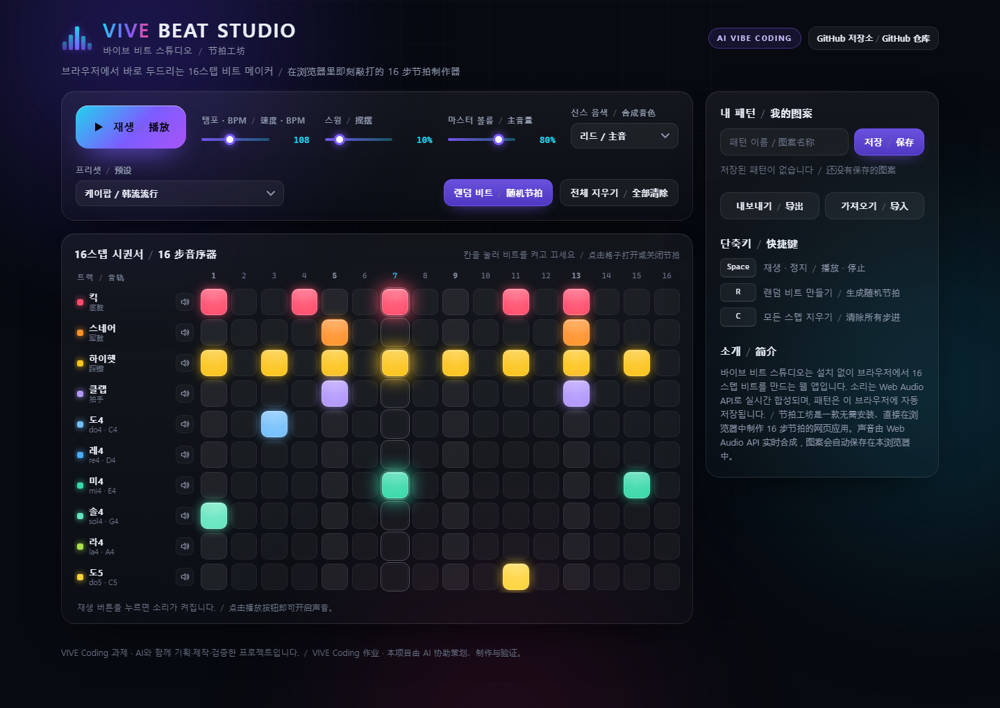
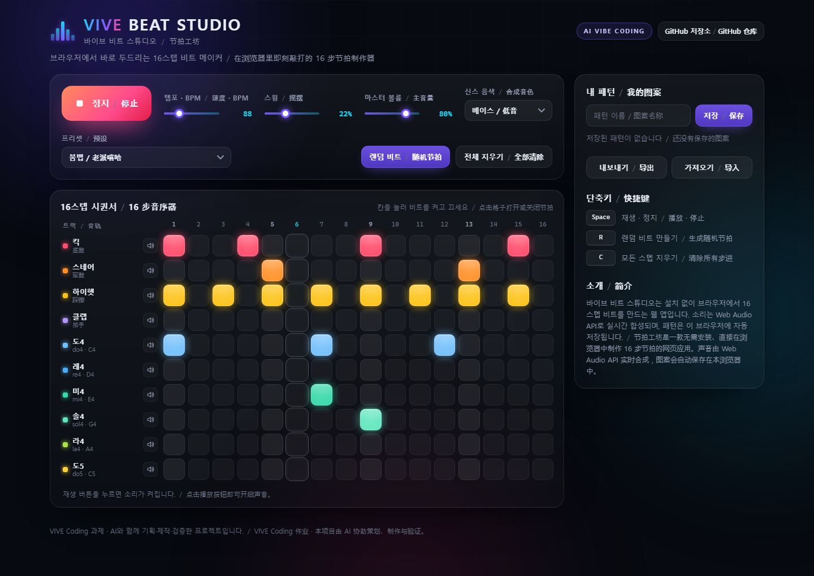
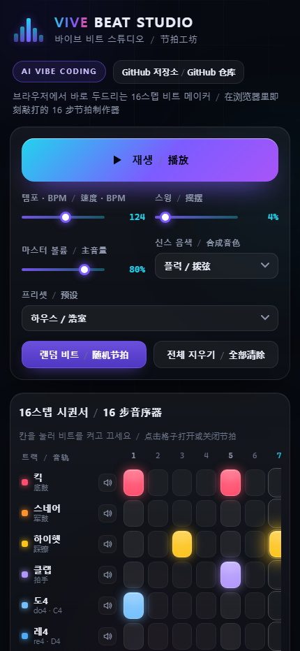

# 바이브 비트 스튜디오 / 节拍工坊 (VIVE BEAT STUDIO)

> 브라우저에서 바로 두드리는 16스텝 비트 메이커
> 在浏览器里即刻敲打的 16 步节拍制作器

설치도, 로그인도, 외부 라이브러리도 필요 없는 **웹 기반 비트 메이킹 앱**입니다.
드럼 4트랙과 펜타토닉 신스 6트랙을 조합해 16스텝 비트를 만들고, Web Audio API로
실시간 합성된 소리를 바로 들을 수 있습니다. 모든 화면 문구는 **한국어 / 중국어**로
동시에 표시됩니다.
无需安装、无需登录、不依赖任何外部库的**网页节拍制作器**。将 4 条鼓组轨道与
6 条五声音阶合成器轨道组合成 16 步节拍，并通过 Web Audio API 实时合成声音。
所有界面文案均以**韩语 / 中文**同时显示。

<p align="center">
  
</p>

---

## 1. 프로젝트 소개 / 项目简介

| 항목 / 项目 | 내용 / 内容 |
| --- | --- |
| 주제 / 主题 | 음악 제작 · 16스텝 비트 메이커 / 音乐制作 · 16 步节拍制作器 |
| 결과물 유형 / 成果类型 | Web App (정적 웹 애플리케이션) / 网页应用（静态网页应用） |
| 핵심 기술 / 核心技术 | HTML · CSS · Vanilla JavaScript · Web Audio API |
| 외부 의존성 / 外部依赖 | 없음 (오프라인 실행 가능) / 无（可离线运行） |
| 언어 / 语言 | 한국어 + 중국어 (UI 전체 이중 언어) / 韩语 + 中文（全界面双语） |

이 프로젝트는 **AI 코딩 에이전트와 대화하며 기획 → 구현 → 검증**하는 방식
(VIVE Coding)으로 제작했습니다. 사람이 목표와 제약을 정하고, AI가 코드를 작성하고,
다시 브라우저에서 자동 검증하는 순환 과정을 거쳤습니다.
本项目采用 **与 AI 编码代理对话完成 策划 → 实现 → 验证**（VIVE Coding）的方式制作。
由人确定目标与约束，AI 编写代码，再回到浏览器中进行自动验证。

---

## 2. 미리 보기 / 预览

| 재생 중 / 播放中 | 모바일 / 移动端 |
| --- | --- |
|  |  |

자체 검증 결과 (15/15 통과): [`docs/screenshots/selftest.png`](docs/screenshots/selftest.png)
自检结果（15/15 通过）：[`docs/screenshots/selftest.png`](docs/screenshots/selftest.png)

---

## 3. 주요 기능 / 主要功能

| # | 기능 / 功能 | 설명 / 说明 |
| --- | --- | --- |
| 1 | 16스텝 시퀀서 / 16 步音序器 | 10개 트랙 × 16스텝 그리드를 클릭해 비트를 켜고 끕니다.<br>点击 10 条轨道 × 16 步的网格来开关节拍。 |
| 2 | 실시간 신스 드럼 / 实时合成鼓组 | 킥·스네어·하이햇·클랩을 샘플 없이 오실레이터와 노이즈로 합성합니다.<br>底鼓、军鼓、踩镲、拍手全部用振荡器与噪声实时合成，无需音频采样。 |
| 3 | 펜타토닉 피아노 롤 / 五声音阶钢琴卷帘 | 도·레·미·솔·라·도(C4–C5) 6개 음높이 행으로 멜로디를 만듭니다.<br>用 do、re、mi、sol、la、do（C4–C5）六个音高行编写旋律。 |
| 4 | 신스 음색 3종 / 三种合成音色 | 플럭 · 리드 · 베이스 음색을 즉시 전환합니다.<br>可即时切换拨弦、主音、低音三种音色。 |
| 5 | 템포와 스윙 / 速度与摇摆 | BPM 60–180, 스윙 0–60%로 그루브를 조절합니다.<br>BPM 60–180、摇摆 0–60%，轻松调整律动。 |
| 6 | 프리셋 4종 / 4 种预设 | 붐뱁 · 하우스 · 트랩 · 케이팝 패턴을 원클릭으로 불러옵니다.<br>一键载入老派嘻哈、浩室、陷阱音乐、韩流流行四种图案。 |
| 7 | 랜덤 비트 / 随机节拍 | 음악적 확률 규칙으로 새로운 비트를 생성합니다.<br>按音乐性概率规则生成全新的节拍。 |
| 8 | 저장 · 불러오기 / 保存与载入 | 내 패턴을 브라우저에 최대 20개까지 저장하고 다시 불러옵니다.<br>最多可将 20 个图案保存在浏览器中并随时载入。 |
| 9 | JSON 내보내기 · 가져오기 / JSON 导出与导入 | 패턴을 파일로 주고받아 다른 기기에서도 이어서 작업합니다.<br>将图案导出为文件，也可在其他设备继续创作。 |
| 10 | 자동 저장 / 自动保存 | 마지막 작업 상태를 자동으로 복원합니다.<br>自动恢复上一次的工作状态。 |
| 11 | 음소거 · 볼륨 / 静音与音量 | 트랙별 음소거와 마스터 볼륨을 지원합니다.<br>支持逐轨静音与主音量调节。 |
| 12 | 단축키 / 快捷键 | Space(재생·정지), R(랜덤), C(지우기).<br>空格（播放·停止）、R（随机）、C（清除）。 |

---

## 4. 실행 방법 / 运行方法

### 방법 A — 파일 열기 (가장 간단) / 方式 A —— 直接打开文件（最简单）

1. 저장소를 내려받습니다. / 下载本仓库。
2. `index.html` 파일을 Chrome · Edge · Safari 등의 최신 브라우저로 엽니다.
   把 `index.html` 用 Chrome、Edge、Safari 等最新浏览器打开。
3. 왼쪽 위 **재생 / 播放** 버튼을 누르면 소리가 시작됩니다.
   点击左上角的 **재생 / 播放** 按钮即可开始发声。

> 브라우저 정책상 첫 소리는 사용자 클릭 이후에만 재생됩니다.
> 受浏览器策略限制，首次声音必须在用户点击之后才会播放。

### 방법 B — 로컬 서버 / 方式 B —— 本地服务器

```bash
# 저장소 루트에서 / 在仓库根目录
python -m http.server 8080
# 또는 / 或
npx serve .
```

브라우저에서 `http://localhost:8080` 을 엽니다. / 在浏览器打开 `http://localhost:8080`。

### GitHub Pages

`main` 브랜치 루트를 GitHub Pages로 배포하면 아래 주소에서 바로 실행할 수 있습니다.
将 `main` 分支根目录发布为 GitHub Pages 后，可通过以下地址直接运行：

**https://jzjz-ai.github.io/vive-beat-studio/**

---

## 5. 사용 방법 / 使用方法

1. **비트 켜기 / 打开节拍** — 그리드의 칸을 클릭합니다. 켜진 칸은 트랙 색으로 빛납니다.
   点击网格中的格子，开启的格子会以轨道颜色发光。
2. **재생 / 播放** — `Space` 또는 재생 버튼. 현재 스텝이 세로로 강조됩니다.
   按空格键或播放按钮，当前步进会纵向高亮。
3. **멜로디 / 旋律** — 아래쪽 도·레·미·솔·라·도 행에 음을 배치합니다.
   在下方 do、re、mi、sol、la、do 行上放置音符。
4. **음색 바꾸기 / 更换音色** — `신스 음색 / 合成音色` 셀렉트를 변경합니다.
   更改“合成音色”下拉菜单。
5. **저장 / 保存** — 오른쪽 `패턴 이름 / 图案名称`에 이름을 적고 **저장 / 保存**.
   在右侧输入图案名称后点击 **저장 / 保存**。
6. **공유 / 分享** — **내보내기 / 导出**로 JSON 파일을 저장하고, 다른 기기에서
   **가져오기 / 导入**로 불러옵니다.
   用 **내보내기 / 导出** 保存 JSON 文件，在另一台设备用 **가져오기 / 导入** 载入。

### 단축키 / 快捷键

| 키 / 按键 | 동작 / 动作 |
| --- | --- |
| `Space` | 재생 · 정지 / 播放 · 停止 |
| `R` | 랜덤 비트 / 随机节拍 |
| `C` | 전체 지우기 / 全部清除 |

---

## 6. 자체 검증 / 自检验证

앱에는 브라우저에서 스스로 동작을 확인하는 **자체 테스트 모드**가 내장되어 있습니다.
应用内置了在浏览器中自动检查功能的**自检模式**。

```text
index.html?selftest=1
```

검증 항목 (15개) / 验证项目（15 项）:

- 이중 언어 사전 · 화면 문구 적용 / 双语文案与界面文本
- 프리셋 16스텝 규격 / 预设 16 步规范
- 패턴 토글 · 초기화 · 직렬화 왕복 / 节拍开关、清空、序列化往返
- 잘못된 데이터 거부 / 非法数据拒绝
- 랜덤 비트 최소 조건 / 随机节拍最低条件
- BPM · 스윙 시간 계산 / 速度与摇摆时间计算
- DOM 그리드 160칸 · 셀 클릭 · 음소거 · 재생 위치 / DOM 网格 160 格、点击、静音、播放位置
- 패턴 저장 / 图案保存
- **오프라인 오디오 렌더링으로 드럼 4종 + 신스 3종 실제 파형 검증**
  **通过离线音频渲染验证 4 种鼓与 3 种合成器的真实波形**

헤드리스 Chrome으로도 같은 검사를 자동 실행할 수 있습니다.
也可以使用无头 Chrome 自动执行相同检查：

```bash
node tools/verify.mjs --url "file:///절대경로/index.html?selftest=1" --selftest
```

결과 예시 / 结果示例: `SELFTEST: PASS 15/15`

스크린샷 자동 생성 / 自动截图：

```bash
node tools/verify.mjs --url "file:///절대경로/index.html?demo=kpop" --shot docs/screenshots/main.png
```

> `tools/verify.mjs`는 Chrome 또는 Edge가 설치되어 있어야 하며, 필요 시
> `CHROME_PATH` 환경 변수로 실행 파일 경로를 지정할 수 있습니다.
> `tools/verify.mjs` 需要安装 Chrome 或 Edge，也可通过 `CHROME_PATH` 指定路径。

---

## 7. 프로젝트 구조 / 项目结构

```text
vive-beat-studio/
├── index.html                 # 앱 진입점 / 应用入口
├── assets/
│   ├── css/style.css          # 다크 네온 UI / 深色霓虹界面
│   └── js/
│       ├── i18n.js            # 한국어·중국어 문구 사전 / 中韩文案词典
│       ├── pattern.js         # 패턴 모델 · 프리셋 · 검증 / 图案模型与预设
│       ├── audio.js           # Web Audio 합성 · 스케줄러 / 合成与调度器
│       ├── app.js             # UI · 저장 · 단축키 / 界面与持久化
│       └── selftest.js        # ?selftest=1 자동 검증 / 自动验证
├── tools/verify.mjs           # 헤드리스 Chrome 검증 · 스크린샷 / 无头浏览器验证
├── docs/screenshots/          # 실행 화면 / 运行截图
├── README.md
└── LICENSE
```

---

## 8. 제작 과정 (VIVE Coding) / 制作过程

1. **목표 정의 / 定义目标** — "브라우저에서 바로 쓰는 16스텝 비트 메이커, 모든 문구는
   한·중 이중 언어"라는 요구사항을 정했습니다.
   确定“打开即用的 16 步节拍器，所有文案中韩双语”的需求。
2. **AI와 설계 / 与 AI 设计** — 화면 구성, 트랙 구성, 오디오 합성 방식, 저장 형식을
   대화로 확정했습니다. / 通过对话确定界面布局、轨道结构、合成方式与存储格式。
3. **AI 코드 생성 / AI 生成代码** — HTML·CSS·JavaScript를 의존성 없이 구현했습니다.
   以零依赖方式实现 HTML、CSS、JavaScript。
4. **직접 실행 · 검증 / 实际运行与验证** — 헤드리스 Chrome으로 15개 자동 테스트를
   돌리고, 스크린샷으로 레이아웃을 확인하며 수정했습니다.
   用无头 Chrome 运行 15 项自动测试，并通过截图检查与修正布局。
5. **GitHub 커밋 · 푸시 / 提交并推送** — 완성된 코드와 README, 스크린샷을 저장소에
   올렸습니다. / 将代码、README 与截图提交到仓库。

---

## 9. 라이선스 / 许可证

MIT License — [LICENSE](LICENSE) 참고 / 详见 [LICENSE](LICENSE).

> ⚠️ 저장소에는 비밀번호, API 키, 토큰, 개인정보, 불필요한 대용량 파일이 포함되어
> 있지 않습니다. / 仓库中不包含密码、API 密钥、令牌、个人信息或无关的大文件。
